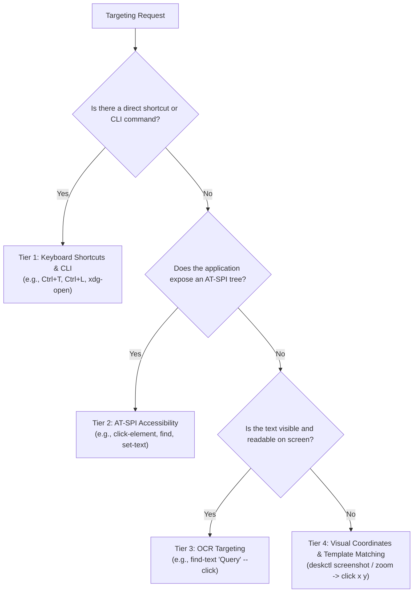

# Deskctl Core Mechanics & Targeting Hierarchy

`deskctl` uses a single global virtual-desktop coordinate system that unifies all connected displays, resolutions, orientations, and scaling factors.

## 1. Targeting Hierarchy: Choosing How to Act

To achieve high reliability, always select targeting methods according to this hierarchy:

### Tier 1: Keyboard Shortcuts and CLI
- **Why**: Immune to screen resolution, window movement, UI theme changes, and visual noise.
- **Examples**:
  - Focus address bar: `deskctl key "ctrl+l"`
  - Open new tab: `deskctl key "ctrl+t"`
  - Save file: `deskctl key "ctrl+s"`
  - Launch application: `deskctl launch "google-chrome"` or `deskctl run "xdg-open /path/to/file"`

### Tier 2: Accessibility (AT-SPI)
- **Why**: Directly queries the application object model; immune to coordinate scaling and DPI.
- **Commands**:
  - `deskctl ui-tree [--window ID] [--filter ROLE] [--max-nodes N]`
  - `deskctl find "<name or label>" [--window ID] [--role ROLE]`
  - `deskctl click-element "<name>" [--role button|menu item|page tab]`
  - `deskctl get-text [--query name]`
  - `deskctl set-text "<value>" [--query name]`
- *Note*: If an app has poor AT-SPI support (e.g. Electron, canvas apps), `deskctl` returns `"fallback": "screenshot_coordinates"`.

### Tier 3: OCR Targeting (Tesseract)
- **Why**: Locate clickable text rendered on canvas or apps without accessibility hooks.
- **Commands**:
  - `deskctl ocr [--screen ID] [--region x,y,w,h]`
  - `deskctl find-text "Submit" --click`

### Tier 4: Visual Coordinates & Pixel Targeting
- **Why**: Universal fallback for custom controls, icons, images, and non-standard UIs.
- **Commands**:
  - `deskctl screenshot [--max-width 1280] [--screen ID]`
  - `deskctl zoom --region x,y,w,h --factor 2`
  - `deskctl click <x> <y> [--button left|right|middle] [--double]`
- **Coordinate Conversion**: Coordinates passed to `click`, `move`, `drag`, and `scroll` are in **image-space** of the most recent screenshot. Deskctl automatically calculates the scale factor and translates them to global screen space.
